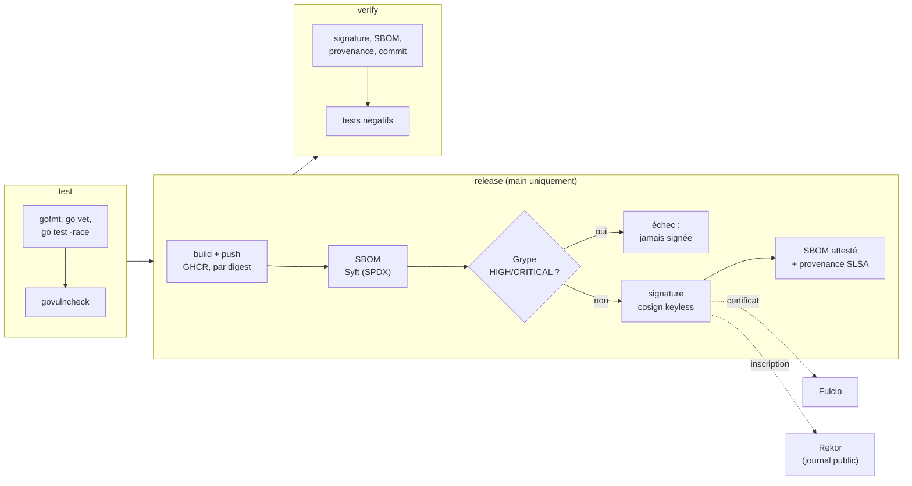

# secure-supply-chain

[](https://github.com/omarsaidiA/secure-supply-chain-o.s/actions/workflows/supply-chain.yml)


Pipeline de **sécurité de la chaîne d'approvisionnement logicielle** : chaque image publiée est
scannée, puis **signée sans clé**, accompagnée d'un **SBOM signé** et d'une **provenance SLSA**.
Un job séparé vérifie le tout comme le ferait un consommateur, puis **essaie de tromper la
vérification** : mauvais signataire, image signée par quelqu'un d'autre, image modifiée.

L'application elle-même est volontairement minuscule (une API Go sans dépendance, dans une image
distroless de 17 Mo) : le sujet, c'est la preuve d'origine de ce qui est déployé.

## Le problème

SolarWinds, Codecov, xz-utils : dans ces attaques, le code source était sain, mais **ce qui a été
livré ne l'était pas**. Un pipeline compromis, un registre modifié ou une dépendance piégée
suffisent. La question à laquelle ce projet répond : *comment prouver que l'image qui tourne a été
construite par mon pipeline, à partir de mon commit, sans modification en route ?*

## Pipeline



| Étape | Outil | Ce que ça apporte |
|---|---|---|
| Vulnérabilités du code | `govulncheck` | Seulement les vulnérabilités **atteignables** par le programme, pas toutes celles des modules importés |
| Build | Buildx | Images de base épinglées **par digest** ; toutes les étapes suivantes visent le digest, jamais un tag modifiable |
| SBOM | Syft (SPDX) | Inventaire de tout ce que contient l'image |
| Scan | Grype | Échec sur HIGH/CRITICAL **avant** la signature : une image vulnérable n'est jamais signée |
| Signature | cosign *keyless* | GitHub fournit une identité OIDC, Fulcio délivre un certificat de 10 minutes lié à ce workflow, la signature est inscrite dans le journal public Rekor. **Aucune clé privée à stocker ou à se faire voler** |
| SBOM signé | `cosign attest` | Le SBOM est lié cryptographiquement au digest de l'image |
| Provenance | `actions/attest-build-provenance` | Attestation SLSA signée : dépôt, commit et workflow qui ont produit ce digest |

## Ce que prouve le job `verify`

[`scripts/verify.sh`](scripts/verify.sh), comme un consommateur ou une barrière de déploiement :

1. La référence est un **digest** ; un tag est refusé.
2. La signature vient **exactement** de `.github/workflows/supply-chain.yml` sur `main` de ce dépôt.
3. Le SBOM est signé par la même identité.
4. La provenance SLSA est valide et donne le commit source.
5. Le binaire lancé (`/version`) annonce **le même commit** que la provenance signée.

[`scripts/tamper-test.sh`](scripts/tamper-test.sh) vérifie que la vérification **échoue** quand elle
le doit, en contrôlant aussi la raison du refus (une erreur réseau ne compte pas comme une réussite) :

| Tentative | Résultat attendu |
|---|---|
| Bonne image, mais on attend un autre workflow ou une autre branche | Refusé : *none of the expected identities matched* |
| Image réellement signée, mais par quelqu'un d'autre (l'image distroless, signée par Google) | Valide pour l'identité de Google, refusée pour la nôtre |
| Image signée à laquelle on ajoute une couche « backdoor » | Refusé : *no signatures found* (nouveau digest) |

L'image modifiée est poussée dans un registre local jetable : rien de falsifié n'est jamais publié.

## Vérifier une image soi-même

```bash
IMAGE=ghcr.io/omarsaidia/secure-supply-chain-o.s@sha256:<digest>   # digest affiché dans le job release

cosign verify "$IMAGE" \
  --certificate-identity https://github.com/omarsaidiA/secure-supply-chain-o.s/.github/workflows/supply-chain.yml@refs/heads/main \
  --certificate-oidc-issuer https://token.actions.githubusercontent.com

gh attestation verify "oci://$IMAGE" --repo omarsaidiA/secure-supply-chain-o.s
```

## Autres choix de sécurité

- **Permissions minimales** : `permissions: {}` par défaut, chaque job ne demande que ce qu'il
  utilise ; seul le job `release` peut écrire dans le registre ou obtenir un token OIDC.
- **Actions épinglées par SHA de commit**, outils en version fixe, Dependabot avec *cooldown*
  (images de base, modules Go et actions).
- **Image distroless `nonroot`** : pas de shell ni de gestionnaire de paquets ; le binaire fait
  lui-même son *healthcheck*. L'image tourne en lecture seule et sans capability.
- **Serveur HTTP durci** : timeouts contre Slowloris, taille d'en-têtes limitée, arrêt propre sur
  SIGTERM, en-têtes de sécurité sur toutes les réponses (y compris les 404 et 405).

## Développement

```bash
go test -race ./...
docker build -t secure-supply-chain .
docker run --rm -p 8080:8080 --read-only --cap-drop ALL secure-supply-chain
curl localhost:8080/version
```

## Licence

[MIT](LICENSE)
